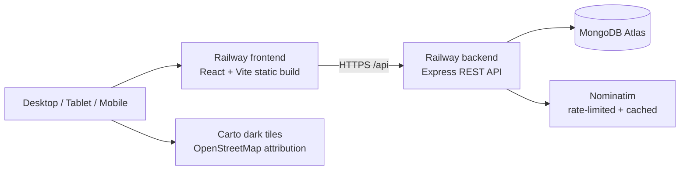

# MediSync System Architecture (MERN Stack)

## 1. Overview & Technology Alignment

MediSync is a full-stack healthcare discovery and hospital navigation platform built on the **MERN** stack:
- **Database**: MongoDB Atlas or local MongoDB + Mongoose ODM. In-memory fallback is development-only and is never used in production.
- **Backend Framework**: Express.js REST API
- **Frontend Framework**: React.js 18+ (Vite, Tailwind CSS, React Router v6, Redux Toolkit, Framer Motion, Lucide React)
- **Runtime Environment**: Node.js v26 LTS

## 2. Deployment and external services



The public hospital directory is restricted to Vijayawada. GPS access is opt-in. Coordinates are used for nearby results and are not persisted as patient data. Nominatim location search is explicit (not autocomplete), bounded to the Vijayawada area, cached, and globally serialized to at most one upstream request per second per backend process.

## 3. Layered Backend Architecture

```
backend/
├── src/
│   ├── config/          # Database and production environment configuration
│   ├── models/          # Mongoose schemas (User, Hospital, BedInventory, Appointment, etc.)
│   ├── routes/          # RESTful Endpoint Definitions
│   ├── controllers/     # Request/Response HTTP handling
│   ├── services/        # Business logic, DB queries, and Nominatim adapter
│   ├── middleware/      # JWT Authentication, RBAC, Centralized Error Handling, Rate Limiting
│   ├── validators/      # Schema & Parameter input validation
│   ├── utils/           # Haversine Geodesic Math & Helpers
│   └── constants/       # Enums for Roles, Statuses, Specialities
```

### Geospatial Indexing
- Hospital locations are stored in strict GeoJSON format:
  ```json
  {
    "type": "Point",
    "coordinates": [longitude, latitude]
  }
  ```
- Backed by MongoDB `2dsphere` indexes.
- Distance calculations utilize `$near` geospatial operators and Haversine geodesic validation in kilometers.

## 4. Frontend Architecture

```
frontend/
├── src/
│   ├── components/      # Common, Layout, Hospital Cards, Leaflet Dark Maps, Modals
│   ├── pages/           # Home, Hospitals Discovery, HospitalDetails, Emergency, Specialities, Compare, Dashboards
│   ├── context/         # AuthContext & CompareContext
│   ├── store/           # Redux Toolkit Slices (authSlice, hospitalSlice, compareSlice)
│   ├── services/        # Centralized Axios API client and feature services
│   ├── hooks/           # useGeolocation and reactive hooks
│   └── routes/          # ProtectedRoute component with Role-Based Access Control
```

## 5. Design System Tokens (70% Black, 20% White, 10% Red)

- Background: `#090909`
- Secondary Background: `#111111`
- Cards: `#171717`
- Elevated / Modals: `#202020`
- Borders: `#303030`
- Primary Text: `#FFFFFF`
- Secondary Text: `#A3A3A3`
- Medical Red: `#E53935` (Palettes: `red-50` through `red-950`)
